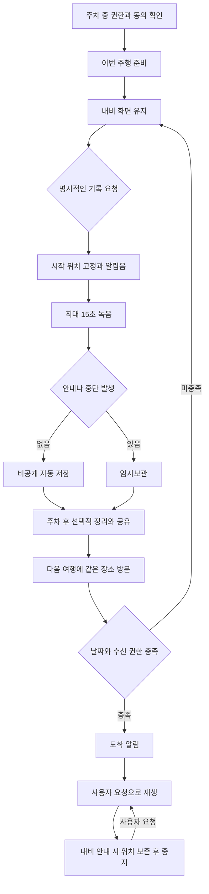

# 타임캡슐 전체 사용자 플로우

작성일: 2026년 11월 2일

타임캡슐은 내비게이션과 함께 쓰는 차량용 음성 기록 앱이다. 핵심 순환은 ‘지나가는 순간을 기록한다 → 주차 후 필요하면 정리한다 → 같은 장소를 다시 방문해 듣는다’이다. 이 문서는 목표 서비스의 흐름을 정의한다. 현재 APK 0.3.0의 구현 여부는 마지막 표에 별도로 표시한다. 제안한 시간·거리·알림 횟수는 검증할 초기 설정이며 안전 기준이나 사용자 조사 결과가 아니다.

## 확정할 핵심 흐름과 알림

사용자가 명시한 핵심 요구는 주행하며 편하게 목소리를 남기고, 내비 화면을 유지한 채 캡슐을 만났다는 알림에서 곧바로 듣는 것이다. 기록과 청취 모두 별도 앱 화면을 여는 행동을 요구하지 않는 것을 목표로 한다.

| 순간 | 목표 표시 | 행동 |
|---|---|---|
| 기록 요청 직후 | 시작음과 시스템 마이크 사용 표시 | 시작음을 듣고 말하기. 제목·날짜·수신자를 묻지 않음 |
| 기록 완료 | ‘이 길에 목소리를 남겼어요’라는 짧은 완료 피드백 | 15초 자동 저장. 확인 버튼·공유 팝업 없음 |
| 캡슐 현장 진입 | ‘이 길의 캡슐이 열렸어요 · 15초’ | 시스템 카드의 ‘듣기 / 넘기기’, 또는 검증된 음성·미디어 입력 |
| 듣기 선택 | 차량 미디어 재생 상태 | 앱을 띄우지 않고 원본 재생. 내비 지도 유지 |
| 내비 음성 개입 | 미디어 상태가 일시정지로 변경 | 내비가 먼저 끝나고 사용자가 요청하면 이어 듣기 |
| 카드에 반응하지 않음 | 시스템이 카드를 닫음 | 자동 재생·반복 알림 없음. 감속·정차·되돌아가기를 유도하지 않음 |

여기서 ‘수집’은 원본 파일을 영구 개방하는 것이 아니라 현장에 도착해 이번 방문의 청취 권한을 얻는 뜻이다. 따라서 기본 문구는 오해하기 쉬운 ‘수집 완료’보다 ‘캡슐이 열렸어요’를 사용한다. 지나가면서 마저 들을 수 있으며, 만료된 방문 권한으로 집에서 새로 듣는 것은 허용하지 않는다. ‘넘기기’는 이번 주행에서 추가로 권하지 않는 동작이다. ‘나중에’라는 버튼으로 집에서도 재생될 것처럼 안내하지 않는다.

목표 카드 예시:

```text
┌ 타임캡슐 ────────────────────────────┐
│ 이 길의 캡슐이 열렸어요 · 15초       │
│       [ 듣기 ]       [ 넘기기 ]      │
└─────────────────────────────────────┘
           내비 지도는 그대로 유지
```

내용·발신자 이름은 기본 알림에 드러내지 않는다. 탑승자 전체에게 보이는 화면이므로 잠금화면의 private 설정만 믿지 않는다. 이미 내비 음성이 진행 중이거나 통화·녹음 중이면 새 청취 알림을 겹치지 않고 보류한다. 보류 중 현장 개봉 권한이 만료되면 ‘지금 듣기’ 카드를 제거한다. 카드의 캡슐 ID와 방문 권한을 묶고 클릭 시 다시 검사해, 오래된 알림이 다른 캡슐을 재생하지 않도록 한다. 한 구역에서 여러 개를 수집하더라도 주행 중에는 카드 하나만 제안한다.

플랫폼 구현 범위는 별도로 확인해야 한다. Pleos의 System Notification 문서는 아이콘·제목·액션 구성을 제공하지만, 이것이 모든 앱에 내비 위 배너 권한을 부여한다는 뜻은 아니다. Android Automotive 표준에서는 일반 앱의 heads-up 카테고리가 제한되고 MediaStyle 알림은 별도 차량 미디어 UI로 처리된다. 현재 0.3.0의 MediaSession 구현만으로 이 배너가 표시된다고 주장하지 않는다. 실제 Pleos 알림 허용 범주·액션 노출을 확인한 뒤 시스템 알림 경로를 연결해야 한다. 임의 오버레이나 잘못된 전화/내비 카테고리 선언으로 대신하지 않는다.

목표 배너가 허용되지 않는 차량에서는 짧은 알림음과 표준 미디어 재생 제어가 가능한 대안이다. 이 경우에는 목표인 ‘내비 위 카드’가 완성되지 않은 상태로 보고하고 제조사 연동을 해결해야 한다. 알림센터를 운전자가 매번 열어야 하는 흐름을 핵심 경험으로 확정하지 않는다.

근거: [Pleos 시스템 알림](https://document.pleos.ai/en/docs/connect/guide/docs-design/components/notification/system-notification), [Android Automotive 알림 제한](https://developer.android.com/training/cars/platforms/automotive-os/notifications).

## 1. 경험을 결정하는 원칙

- 주행 중에는 기록 시작, 현재 녹음 저장·취소, 재생·중지처럼 짧고 독립적인 명령만 제공한다. 이름 입력, 날짜·수신자 선택, 검색 결과 탐색은 주차 후 처리한다.
- 내비를 기본 화면으로 유지한다. 캡슐 도착이나 녹음 때문에 앱을 전면으로 띄우거나 지도 위에 팝업을 덮지 않는다.
- 녹음은 명시적인 사용자 요청 이후만 시작한다. 준비 상태와 실제 녹음 상태를 구분한다. 상시 녹음과 소급 저장은 하지 않는다.
- ‘지금 남겨줘’ 전에 한 말은 복원할 수 없다. 시작음을 듣고 말하도록 설명한다. ‘방금 한 말 저장’이 이미 지나간 음성을 가져온다는 인상을 주지 않는다.
- 새 캡슐은 나만 보관이 기본이다. 팔로우 승인과 개별 음성 공유 승인은 별개다. 동승자의 목소리가 포함되면 공유도 동의를 확인한다.
- 알림에 답하지 않아도 손해나 실패가 없다. 카운트다운, 빨리 듣기, 유턴 유도, 재시도 독촉을 사용하지 않는다.
- 듣기는 처음에는 알림 후 사용자가 시작하는 방식이다. 자동 청취는 별도로 선택한 사람에게만 제공한다.
- 신호 대기로 속도가 0이 되어도 설정·편집 화면을 열지 않는다. P단과 플랫폼의 주행 제한 해제를 함께 확인한다.

## 2. 화면과 입력의 역할

| 사용 환경 | 할 일 | 입력 및 출력 |
|---|---|---|
| 차량 주차 중 | 권한, 이번 주행 준비, 날짜·수신자·공개 범위, 보관함, 삭제 | 차량 화면; 복잡한 계정 작업은 향후 보조 웹/폰으로 연결 |
| 차량 주행 중 | 순간 기록, 녹음 저장·취소, 캡슐 듣기·중지 | 검증된 차량 음성 명령/전용 기록 입력과 표준 미디어 제어; 짧은 알림음 |
| 목적지 주차 후 | 중단된 녹음 확인, 공유, 날짜 수정, 여행 정리 | 차량 화면; 선택적으로 보조 웹/폰 |
| 차 밖 | 가족 초대·친구 수락, 보관함 관리, 계정 이전 | 향후 보조 채널. 장소가 잠긴 음성의 원격 재생 우회는 제공하지 않음 |

일반 PLAY 버튼은 계속 재생을 뜻한다. RECORD 전용 키나 명시적인 기록 액션만 녹음한다. 전용 키가 없는 차량에는 있다고 가정하지 않는다. 제조사 음성 연동이 검증되지 않으면 주행 중 기록을 소비자용으로 완료했다고 표시하지 않는다.

## 3. 첫 설치부터 첫 주행까지

1. P단에서 앱을 연다. 차량·위치 지원 여부를 확인한다. 계정 없이 ‘나에게 남기기’부터 시작할 수 있다.
2. ‘시작음을 듣고 말하면 그 위치에 저장됩니다’를 짧게 안내한다. 튜토리얼 청취와 테스트 녹음은 주차 중 선택할 수 있다.
3. 위치 기능을 처음 사용할 때 위치 권한을, 기록을 처음 준비할 때 마이크 권한을 요청한다. 둘을 앱 실행 즉시 무조건 요구하지 않는다.
4. 위치 거부 시 장소에 묻기·현장 개봉을 사용할 수 없음을 설명한다. 마이크 거부 시 녹음만 제한하고 이미 보관한 캡슐 청취는 허용한다. 반복 권한 팝업은 띄우지 않는다.
5. 동승자 녹음 동의를 확인한다. 가족 계정 가입이나 운전자 동의만으로 모든 동승자 동의를 대신하지 않는다.
6. 목표 UX에서는 ‘이번 주행 시작’ 한 번으로 이전에 선택한 기록/청취 설정을 확인하고 준비한다. 기본은 기록 준비 + 알림 후 청취다. 이 설정 확인은 마이크를 실제로 녹음하는 동작이 아니다.
7. 내비로 이동한다. 목적지를 타임캡슐에 다시 입력할 필요가 없다.

현재 0.3.0은 기록 준비와 듣기 준비가 별도 버튼이다. 하나의 출발 흐름으로 합치는 것이 다음 UI 개선 사항이다. Android의 백그라운드 마이크 제약 때문에 현 구현은 주차 중 마이크 foreground service를 준비한다. 최종 목표는 사전 권한·동의가 있을 때 시스템 음성 요청으로 직접 시작하는 것이며, Gleo 호출 권한과 플랫폼 정책 검증이 선행돼야 한다.

## 4. 주행 중 새 캡슐을 남기는 기본 흐름

1. 운전자 또는 동의한 동승자가 ‘타임캡슐, 지금 남겨줘’라고 명시적으로 요청한다. 검증된 전용 기록 버튼도 같은 동작을 한다.
2. 호출 수신 시점의 위치를 고정한다. 내비 화면은 유지한다. 기록 가능 여부를 확인한 뒤 시작음을 낸다.
3. 시작음 뒤 사용자가 말한다. 기본 최대 15초를 녹음한다. 말하는 동안 ‘누구에게 보낼까요?’, ‘언제 열까요?’를 묻지 않는다.
4. 제한 시간이 지나면 자동 저장한다. ‘저장’ 명령은 더 일찍 마친다. ‘취소’는 현재 녹음만 버린다. 시작 명령이 중복돼도 타이머를 늘리거나 새 파일을 만들지 않는다.
5. 저장 위치는 끝난 장소가 아니라 시작한 장소다. 기본 소유자는 본인, 공개 범위는 비공개, 열리는 날은 지금부터다. 출발 전에 별도 날짜를 설정했으면 그 설정을 쓴다.
6. 완료음을 한 번 낸다. 제목은 날짜·장소로 자동 생성한다. 완료 확인 화면, 공유 팝업, 별점 요청은 없다.
7. 계속 운전한다. 바로 되듣기를 자동 실행하지 않는다. 가족에게 공유하거나 편지로 바꾸는 일은 도착 후 처리한다.

15초는 초기 제품 설정이다. 실제 발화 완료율과 부담을 비교해 조정한다. 받아쓰기나 무음 자동 종료는 현재 구현 범위가 아니다. 음성 인식 없이도 정해진 길이의 원본 녹음은 저장할 수 있다.

## 5. 기록 도중 다른 일이 생기는 경우

| 사건 | 목표 동작 | 사용자에게 남는 결과 |
|---|---|---|
| 내비 안내·통화가 오디오 우선권을 가져감 | 녹음을 마치고 앞부분을 임시보관; 자동 녹음 재개 없음 | 다음 주차 때 확인하거나, 안내 종료 후 새 명령으로 새 캡슐 기록 |
| 방향지시등 등 현재 앱이 감지하는 보류 조건 | 새 기록을 시작하지 않거나 진행분을 임시보관 | 반복 질문 없이 운전에 집중; 급제동·ADAS 전체 감지는 별도 구현 필요 |
| 위치를 잃음 | 녹음 시작 위치가 이미 유효하면 그 위치를 보존; 불확실한 연결은 임시보관 | 끝난 위치로 임의 대체하지 않음 |
| 처음부터 위치를 못 얻음 | 목표 UX는 ‘장소 미확정 메모’로 음성만 보관한 후 주차 때 정리 | 현재 APK는 시작을 거절함. 중요한 순간을 잃는 문제라 다음 개선 우선순위가 높음 |
| 마이크 권한 취소·다른 앱이 마이크 점유 | 실패/중단을 짧게 알리고 성공 저장으로 표시하지 않음 | 유효한 부분만 임시보관; 파일이 유효하지 않으면 저장 실패 |
| 잘못 호출함 | 취소 명령으로 현재 녹음 삭제 | 이미 저장한 다른 캡슐에는 영향 없음 |
| 저장 공간 부족 | 시작 전 여유 확인, 저장 실패 시 분명히 알림 | 저장 완료음을 내지 않음. 저장 용량 사전 점검은 후속 구현 |
| 앱 프로세스 종료·전원 차단 | 몰래 녹음을 재개하지 않음; 유효한 임시 파일을 다음 실행에서 복구 제안 | 복구 파일 검사·정리는 후속 구현. 현재 갑작스러운 강제 종료의 녹음 복구를 보장하지 않음 |
| 기록 준비를 하지 않았음 | 주행 중 화면 설정을 요구하지 않음 | 최종적으로 시스템 음성 승인 경로를 지원; 현재는 기록 불가. 음성 연동 검증이 핵심 출시 조건 |

## 6. 같은 장소를 다시 지날 때

1. 출발 전에 수신 캡슐의 음성을 내려받을 수 있다. 음성을 내려받는 것과 개봉 권한을 얻는 것은 다르다.
2. 차량이 저장된 구역에 접근한다. 새 위치, 개봉일, 본인 또는 수신 권한을 검사한다. 내비에 목적지가 없어도 실제 위치로 동작한다.
3. 기본 모드는 짧은 도착 알림만 제공한다. 상세한 사연과 발신자 이름을 큰 소리로 읽지 않는다. 상대의 메시지라는 사실 자체도 민감할 수 있다.
4. ‘들려줘’ 또는 미디어 PLAY 요청에 원본을 재생한다. 타임캡슐 화면으로 전환하지 않는다.
5. 내비 안내 시 재생 위치를 보존해 멈춘다. 안내 종료 후 자동으로 다시 틀지 않는다. 사용자가 재개하면 같은 위치부터 이어 듣는다.
6. 한 번 현장에서 열린 캡슐은 현재 방문의 유효기간 안에서는 구역을 지나도 마저 듣는다. 현재 구현은 5분이다. 듣기 위해 차를 세우거나 속도를 줄일 이유를 만들지 않는다.
7. 완료하면 다음 캡슐을 연달아 틀지 않는다. 같은 장소에 캡슐이 많으면 그 방문에는 하나만 제안하고 나머지는 주차 때 확인한다.
8. 답하지 않거나 지나치면 아무 일도 하지 않는다. 오늘 놓쳤다는 경고나 경로 변경 제안은 없다. 다음 방문에 다시 만날 수 있다.

‘그 길에 가야 열린다’는 개봉 조건이고, ‘그 구역 안에서 끝까지 머물러야 한다’는 체류 조건이 아니다. 재시작·세션 종료·5분 만료 후에는 방문 권한을 재사용하지 않는다. 현재 100m 반경은 같은 도로를 보장하지 못한다. 평행도로·고가도로·반대편 진입을 분리하려면 도로 매칭을 추가해야 한다. 이동 방향 자체는 기본 개봉 조건으로 삼지 않는다. 또한 시속 100km에서는 10초 동안 약 278m를 이동한다. 현재 위치의 10초 유효성 기준만으로 ‘방금 그 지점’을 정확히 기록한다고 볼 수 없으므로, 호출 시각과 위치 샘플의 차이·정확도·속도를 함께 검증해야 한다.

## 7. 내비·음악·기록이 겹칠 때

- 내비 지도는 계속 전면에 둔다. 앱 전환은 사용자가 주차 중 요청할 때만 한다.
- 차량 안전 안내·통화·내비 음성의 우선순위는 차량 오디오 정책을 따른다. 앱이 높은 우선순위를 임의로 빼앗지 않는다.
- 캡슐 재생 중 기록 요청이 오면 재생을 보류하고 기록한다. 기록이 끝나도 재생을 자동 재개하지 않는다.
- 기록 중 캡슐 장소에 도착하면 녹음을 우선 마친다. 캡슐 음성을 녹음에 섞거나 새 알림으로 재촉하지 않는다.
- 음악 감상 중에는 시스템 오디오 포커스에 따라 중단/복귀한다. 타임캡슐이 타사 음악을 직접 제어한다고 가정하지 않는다. 현재 청취 준비는 기존 음악 대신 타임캡슐을 미디어 소스로 선택하는 방식이다.
- 주행 중 민감하거나 감정적인 메시지의 자동 재생은 기본 꺼짐이다. ‘다음에 듣기’를 선택해도 손실이 없다. 내용 분류를 AI가 정확히 할 수 있다고 가정하지 않는다.
- 일반 PLAY, PAUSE, NEXT, STOP의 의미는 유지한다. 기록 버튼을 PLAY에 숨기지 않는다.

## 8. 도착 후 정리

1. P단과 주행 제한 해제가 확인되면 ‘이번 여행에 남긴 목소리’를 볼 수 있다. 시동 종료 자체가 화면 조작 가능 조건은 아니다.
2. 정상 저장된 캡슐은 정리하지 않아도 유효하다. 임시 녹음만 별도로 표시한다.
3. 임시 녹음은 원래 시작 위치를 보여주고 ‘캡슐로 저장 / 삭제’를 선택한다. 이 확인이 끝나기 전에는 누구에게도 공유하지 않는다.
4. 정상 캡슐의 제목·개봉일·공개 대상을 수정할 수 있다. 현재 APK는 생성 전 지금/1년 뒤 선택과 삭제만 지원한다. 저장 후 날짜·제목·공유 편집은 후속이다.
5. 여행 앨범은 캡슐 묶음과 위치 요약을 제공한다. ‘여행 종료’ 감지는 후속이며 미러 접힘만으로 동승자나 여행 완료를 단정하지 않는다.
6. 아무 정리도 하지 않고 차에서 내려도 녹음은 로컬에 남는다. 자동 업로드·공개로 대신 처리하지 않는다.

## 9. 가족과 공유하는 흐름

1. 주차 중 계정을 연결하고 가족 그룹을 만든다. 초대 링크에는 음성 원본이나 정확한 좌표를 넣지 않는다.
2. 상대가 초대를 수락하면 가족 관계가 생긴다. 기존의 비공개 캡슐이 일괄 공개되지는 않는다.
3. 발신자가 캡슐을 선택해 특정 가족 또는 그룹에 공유한다. 누가 들을 수 있는지, 위치 조건·공개일을 확인하고 저장한다.
4. 받은 사람에게는 허용한 장소명·열리는 날짜 등 최소 정보만 보여준다. 발신자의 실시간 위치와 전체 이동 경로는 공유하지 않는다.
5. 받은 사람도 현장과 날짜 조건을 충족해야 음성을 듣는다. 폰 알림·공유 링크·앨범 내보내기가 조건을 우회하지 않는다.
6. 발신자가 공유를 철회하면 새로운 개봉을 막고 캐시 정리를 요청한다. 오프라인 기기의 즉시 삭제는 보장할 수 없으므로, 공유 캡슐의 새 개봉에는 서버 권한 확인을 요구하는 정책을 우선 검토한다.
7. 그룹에 나중에 들어온 사람에게 과거 캡슐을 자동 공개하지 않는다. 그룹 탈퇴 후에는 새로운 개봉 권한을 잃는다.
8. 이미 다른 사람이 들었거나 별도로 녹음한 음성까지 회수할 수 있다고 약속하지 않는다.

## 10. 친구와 상호 팔로우

1. 계정/초대 코드로 상대를 찾고 연결을 요청한다. 주행 중에는 검색·수락을 하지 않는다.
2. 상대 수락 후 상호 연결이 성립한다. 일방적인 팔로우만으로 길 위 음성에 접근하지 못한다.
3. 작성자는 ‘친구에게 공유’를 선택한 캡슐만 노출한다. 모든 녹음·가족 캡슐·임시보관은 그대로 비공개다.
4. 친구의 캡슐도 현장 진입과 개봉일·권한 검사를 거친다. 주변에 있다는 이유로 모르는 사람의 목소리를 자동 재생하지 않는다.
5. 차단은 새 개봉·연결·알림을 막는다. 신고는 주차 중 캡슐 단위로 제출한다. 위치·음성 접근 권한 변경은 서버에서 처리한다.
6. 친구 목록과 가족 그룹은 별개다. 친구 해제 여부와 가족 그룹 권한을 혼동하지 않게 표시한다.

초기 MVP에서 공개 캡슐 피드와 불특정 다수 팔로우는 제외한다. 먼저 비공개 기록과 수락한 상대에게 보내는 편지를 완성한다.

## 11. 미래의 나와 편지 캡슐

1. 기본 녹음은 바로 만들어 두고 주차 후 개봉일과 받는 사람을 지정한다.
2. 날짜 전에는 제목·장소 힌트만 보이며 원본 재생을 허용하지 않는다. 작성자 미리듣기 예외를 둘지는 정책 선택인데, 본 설계는 ‘자신에게 보내기’도 같은 잠금 규칙을 유지한다.
3. 개봉일이 와도 집에서 자동으로 재생되지 않는다. 날짜와 현장 조건을 모두 충족해야 한다.
4. 아직 계정이 없는 아이에게 보내려면 보호자가 관리하는 초대 대기 상태를 두고, 성인이 된 후 본인 확인·수락으로 연결한다. 자동 상속이나 법적 대리 권한을 가정하지 않는다.
5. 18년 뒤 재생은 서비스 비전이다. 보관 기간 보장, 계정 복구, 회사 종료 시 원본 회수 정책 없이 실제 보장으로 표시하지 않는다.

## 12. 네트워크·기기·계정의 예외

| 상황 | 목표 정책 |
|---|---|
| 인터넷 없음 | 본인 로컬 캡슐 기록·개봉 가능. 공유 캡슐의 새 개봉은 최신 권한 확인이 안 되면 보류. 반복 오류 안내 없음 |
| 위치 불명확·터널 | 새로운 현장 개봉을 보류. 유효하게 열린 재생의 지속 여부는 기존 방문 권한 정책으로 판단. 현재 APK는 위치가 만료되면 재생도 일시정지함 |
| 앱 재시작 | 몰래 녹음·청취를 시작하지 않음. 이미 저장된 파일은 복구하고 다음 출발 준비를 받음 |
| 다른 운전자가 탑승 | 앱 계정을 명확히 전환. 차량 탑승/좌석만으로 가족 신원을 추정하지 않음. 이전 운전자 음성은 자동 노출하지 않음 |
| 로그아웃 | 준비 세션 종료, 업로드 대기·로컬 파일 보관 여부 안내, 서버 권한 회수. 공유 차량에는 로컬 기록 제거를 기본 제안 |
| 차량 판매·교체 | 주차 중 계정 동기화/안전한 이전 완료를 확인한 후 기존 차량 파일과 로그인 해제. 이전 성공 전에 원본을 삭제하지 않음 |
| 계정 탈퇴 | 공유 접근 종료, 클라우드·연결기기 삭제 범위와 보존 정책 안내. 오프라인 기기의 삭제 완료는 별도로 추적 |
| 서비스 종료 | 사전 안내와 본인 원본 회수 수단 제공. 장소 잠금과 원본 회수의 충돌은 명시적인 보관 종료 정책으로 설명 |
| 시계·위치 조작 | 공유 캡슐은 서버 시간·서명된 권한 검증을 고려. 현재 로컬 APK는 기기 시계·모의 위치 조작 방지를 보장하지 않음 |

## 13. 상태와 전환

기록 상태는 `꺼짐 → 준비됨 → 녹음 중 → 저장 완료 또는 임시보관 → 준비됨`이다. 저장·취소는 현재 녹음에만 작용하며, 종료·만료·계정 변경은 준비 상태까지 해제한다. 앱 재시작 시에는 꺼짐에서 시작한다.

청취 상태는 `꺼짐 → 장소 대기 → 현장에서 개봉 가능 → 재생 중 ↔ 일시정지 → 완료 또는 건너뜀 → 장소 대기`이다. 세션 종료나 방문 권한 만료 시 기존 개봉 권한을 폐기한다.

공유 상태는 `비공개 → 대상 선택 → 공유 활성 → 철회 또는 권한 만료`이다. 이 상태는 녹음 성공 여부, 캡슐 날짜 잠금, 현장 개봉 상태와 별도로 관리한다. ‘팔로우했다’는 사실 하나로 모든 조건을 해제하지 않는다.



## 14. 현재 구현과 다음 단계

| 기능 | 0.3.0 상태 | 다음 작업 |
|---|---|---|
| P단 설정과 실제 CarUxRestrictions | 구현·에뮬레이터 확인 | 차량별 제한과 화면 노출 확인 |
| D단·내비 전면에서 15초 기록 | 구현·서명된 테스트 제어 명령으로 확인 | 실제 Gleo 호출과 마이크 음질 확인 |
| 전용 RECORD 키 | 에뮬레이터 입력 확인 | 실물 차량 버튼 매핑 확인 |
| Gleo 스키마·명령 수신 코드 | 구현, 시스템 미디어 권한으로 보호 | 스키마 심사, 실제 발신자 권한, 음성 인식부터 녹음까지 종단 검증 |
| 내비 포커스와 기록 임시보관 | 별도 NAVIGATION 포커스 도구로 확인 | 실제 경로 안내·통화·안전 알림 시험 |
| 현장 개봉, 재개, 날짜 잠금 | 로컬 구현 | 도로 매칭과 위치 정확도 검증 |
| 내비 위 현장 개봉 알림과 듣기 액션 | 목표 UX, 현재 배너 미구현 | Pleos 노출 정책·시스템 액션 연동 검증 |
| 출발 준비 한 번으로 기록·청취 설정 | 현재 두 버튼 | 한 화면·한 행동으로 통합 |
| 위치 없이 순간 음성 보존 | 미구현, 현재 기록 시작 거절 | 장소 미확정 임시 메모 설계·구현 |
| 저장 후 제목·날짜·대상 수정 | 삭제/임시보관 확정 외 미구현 | 주차 후 정리 화면 |
| 가족·친구·서버 권한·동기화 | 미구현 | 계정·ACL·초대·차단·권한 철회부터 구축 |
| 여행 앨범·추억 경로·차량 이전 | 미구현 | 핵심 기록·재방문·공유가 검증된 뒤 구현 |

출시 전 가장 먼저 확인할 것은 디자인 추가가 아니라, 운전자가 실제로 음성/전용 입력으로 기록을 시작할 수 있는지이다. 그다음은 기록을 놓치지 않는 실패 복구, 장소 판정, 공유 권한이다.

## 15. 사용자 평가

첫 주차 설정, 내비를 유지한 기록, 안내로 중단된 녹음, 장소를 지나며 청취, 수신자 오지정 방지, 로그아웃 후 정보 노출을 시뮬레이터에서 평가한다. 실제 도로 주행을 하면서 조작 시험을 요구하지 않는다.

측정 항목은 기록 시작 성공률, 중복 호출률, 음성 끝부분 잘림, 저장 성공에 대한 오해, 화면을 찾는 행동, 안내와 음성 겹침, 임시 녹음 회수율, 잘못된 도로에서 개봉한 횟수다. 음성 인터페이스라는 이유만으로 주의 분산이 없다고 가정하지 않는다. 가족·커플·혼자 운전하는 사용자, 차량 음성 기능에 익숙하지 않은 사용자를 포함해 검증한다.

## 근거와 한계

- Pleos 주행 안전 설계: https://document.pleos.ai/en/docs/pleos-only/vehicle-app-planning-guide/driver-distraction-guideline
- Pleos 지역별 주행 제한: https://document.pleos.ai/en/docs/pleos-only/vehicle-app-planning-guide/driving-restiction-policy
- Google 차량 상호작용 원칙: https://developers.google.com/cars/design/design-foundations/interaction-principles
- Gleo 스키마 배포·심사: https://document.pleos.ai/en/docs/pleos-only/app-integration-guide/guide/deliver-schema
- Android 백그라운드 마이크 제약: https://developer.android.com/develop/background-work/services/fgs/restrictions-bg-start

공식 가이드는 주행 중 선택·시각적 부담을 줄이는 근거다. 위의 제품별 흐름, 시간·거리 설정, 계정·공유 정책은 이 프로젝트의 설계 제안이다. 실차·사용자 연구 결과로 가장하지 않는다.
